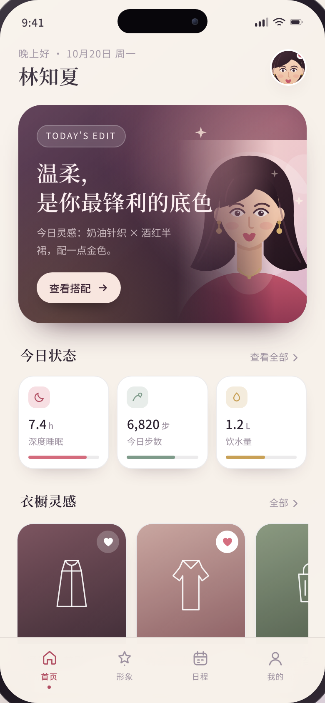
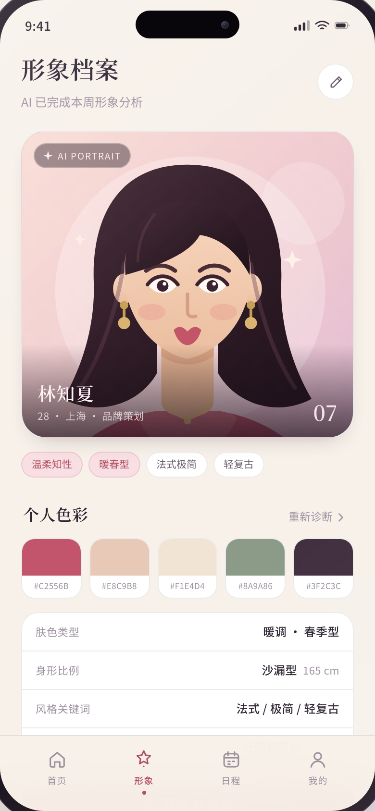
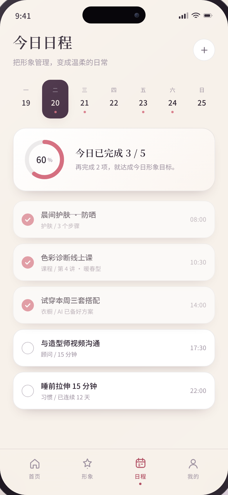
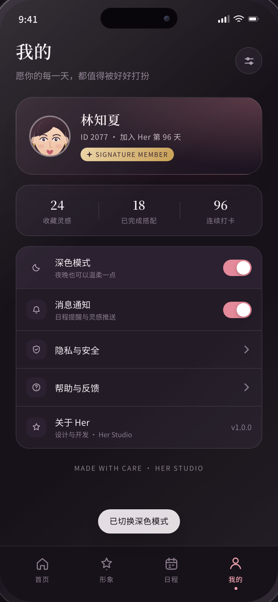

# Her · 女性形象 App 高保真 UI 原型

一个以「女性形象管理」为主题的单页移动端 UI 原型。全部由 **HTML + CSS + 原生 JavaScript** 实现，
没有任何构建步骤和第三方依赖，直接用浏览器打开 `index.html` 即可体验。

> 打开方式：双击 `index.html`，或在本目录执行 `python3 -m http.server 8000` 后访问
> <http://localhost:8000/>（使用本地服务器时，「复制色值」功能在部分浏览器中可用性更好）。

---

## 预览

<p align="center">
  
  
  
  
</p>

桌面端以手机外框（390 × 844）展示在品牌介绍旁；窗口宽度 ≤ 560 px 时自动切换为全屏 App 布局。


## 设计语言

| Token | 值 | 用途 |
| --- | --- | --- |
| `--rose` | `#D46C7D` | 主品牌色、强调、进度环 |
| `--plum` | `#432C41` | 深色 Hero、选中日期 |
| `--gold` | `#C8A055` | 会员、珠宝与引语点缀 |
| `--sage` | `#7E9B8A` | 健康数据辅助色 |
| `--bg` | `#F7F1EA` | 暖米色背景 |
| `--card` | `#FFFFFF` | 卡片表面 |

- **字体**：标题用衬线字体（Songti SC / Noto Serif SC / Noto Serif CJK SC），正文用系统无衬线字体，
  在没有安装中文字体的 Linux 环境中回退到 Noto Sans CJK SC。
- **圆角**：卡片 18–28 px，手机外框 46–56 px，胶囊按钮 999 px。
- **插画**：女性形象完全由内联 SVG 绘制（渐变、发丝、耳饰、项链），可通过 `<symbol id="portrait">`
  统一替换，不依赖任何图片资源。

## 页面与交互

1. **首页** — Hero 灵感卡片、今日状态（睡眠 / 步数 / 饮水）、横向滑动的衣橱灵感、每日一句。
2. **形象档案** — 大幅形象插画、风格标签、个人色板（点击任意色块复制色值）、身形与风格信息、AI 试衣 CTA。
3. **今日日程** — 周日历切换、完成进度环、任务打卡（勾选后进度与文案实时更新）。
4. **我的** — 会员资料、数据统计、深色模式开关、消息通知开关、设置入口。

已实现的交互：

- 底部 Tab 切换页面，支持 `←` / `→` 键在 Tab 间移动焦点（遵循 `tablist` 语义）。
- 任务打卡：环形进度、百分比、剩余项提示同步更新，并弹出 Toast。
- 收藏按钮：`aria-pressed` 状态、图标高亮与弹跳动画、Toast 反馈。
- 色板点击复制十六进制色值（安全上下文使用 Clipboard API，否则降级到 `execCommand`）。
- 深色 / 浅色主题切换（CSS 变量 + `data-theme`），同步更新 `<meta name="theme-color">`。
- 所有次要操作（查看全部、预约顾问等）通过 `data-toast` 属性统一给出反馈。

## 可访问性与适配

- 语义化结构：`nav[role="tablist"]`、`section[role="tabpanel"]`、`aria-selected`、`aria-controls`、
  `aria-hidden` 同步维护；开关使用 `role="switch"` + `aria-checked`。
- 可见的 `:focus-visible` 焦点环；Toast 使用 `aria-live="polite"`。
- 尊重 `prefers-reduced-motion`，关闭过渡与动画。
- 布局基于 `dvh` 与 `env(safe-area-inset-*)`，适配刘海屏与移动端浏览器工具栏。
- 颜色在浅色 / 深色主题下均保持文字与背景的对比度。

## 文件结构

```
.
├── index.html   # 原型全部内容：设计变量、组件样式、四个页面、内联 SVG 与交互脚本
└── README.md
```

## 说明与限制

- 这是一个**前端原型**：数据为演示用静态内容，没有后端、路由与持久化；刷新后状态重置。
- 插画为风格化矢量人物，仅用于演示视觉语言，可替换为真实摄影或品牌插画。
- 若浏览器禁止本地文件读取剪贴板，复制色值会降级为提示色值文本。
- 推荐使用 Chromium / Safari 最新版本查看；`color-mix()`、`dvh`、`backdrop-filter` 在旧版浏览器中可能降级。
